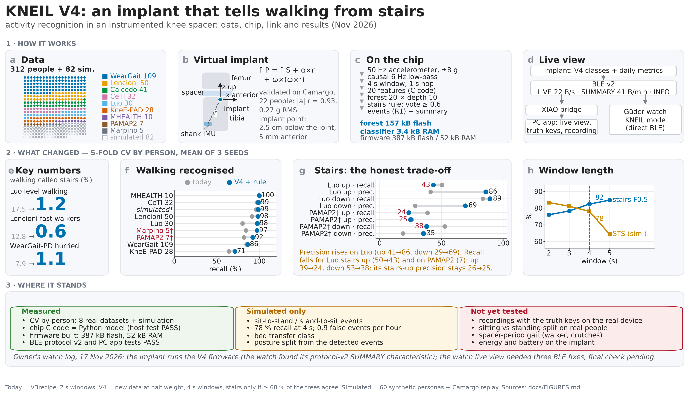
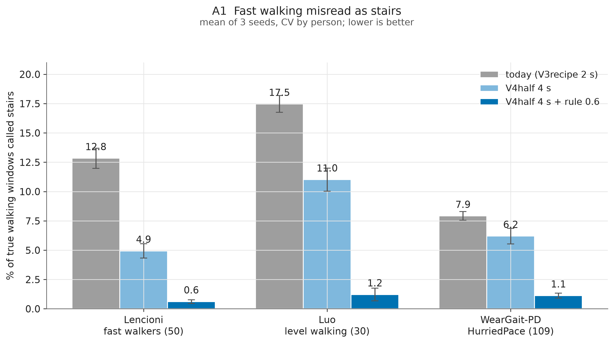
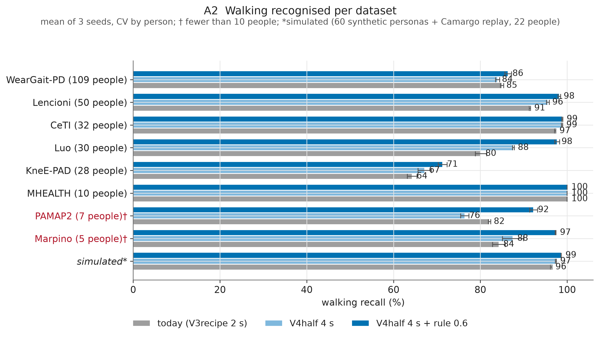
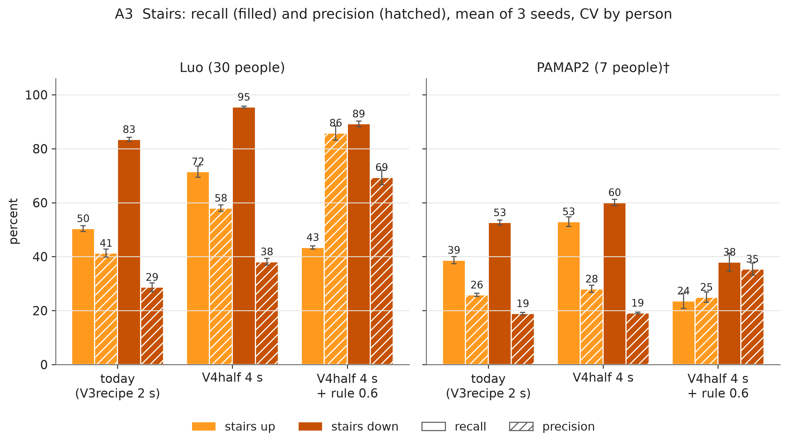
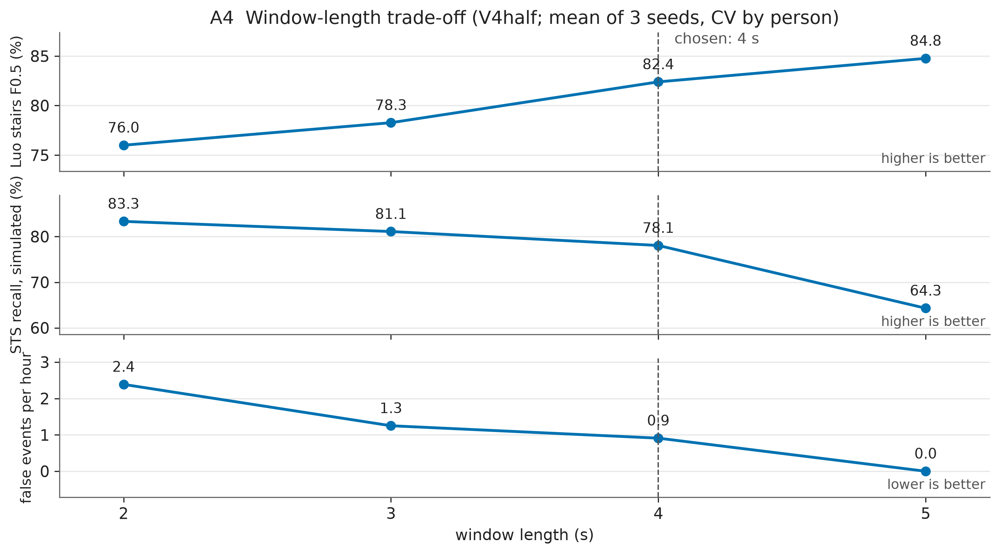
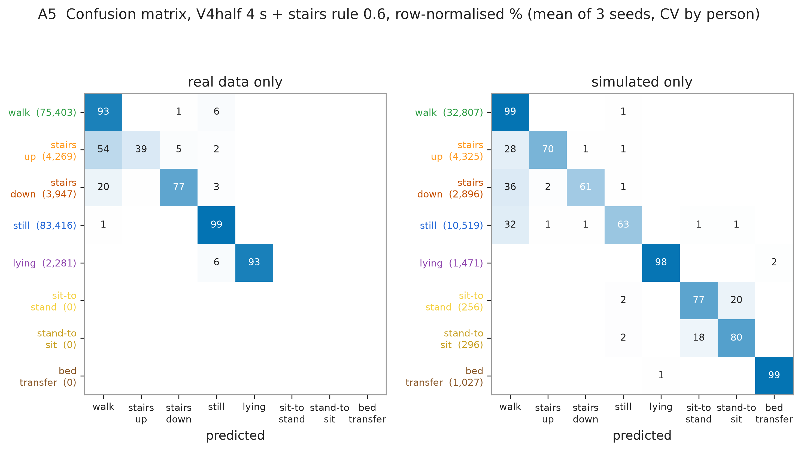
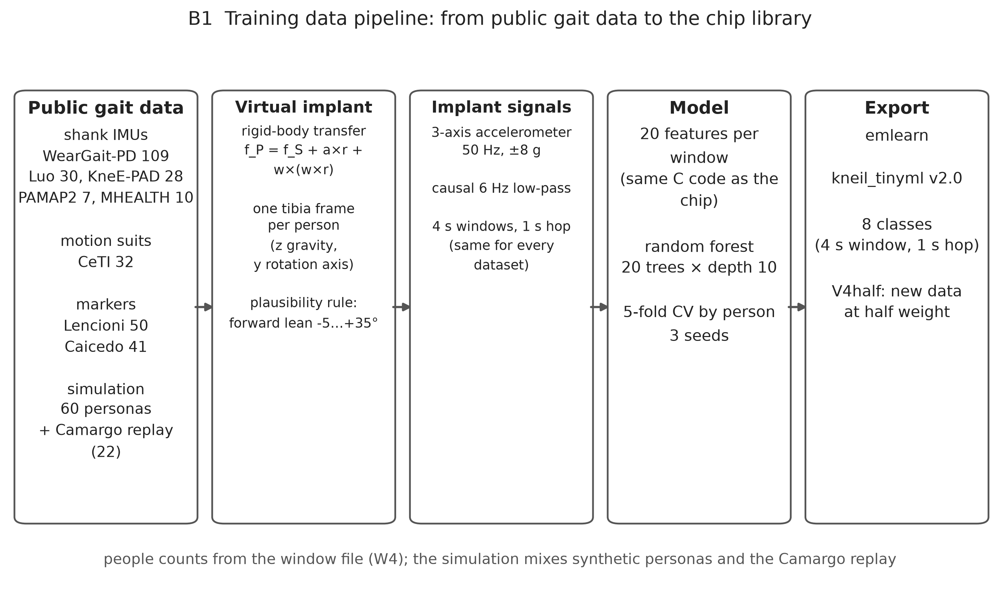
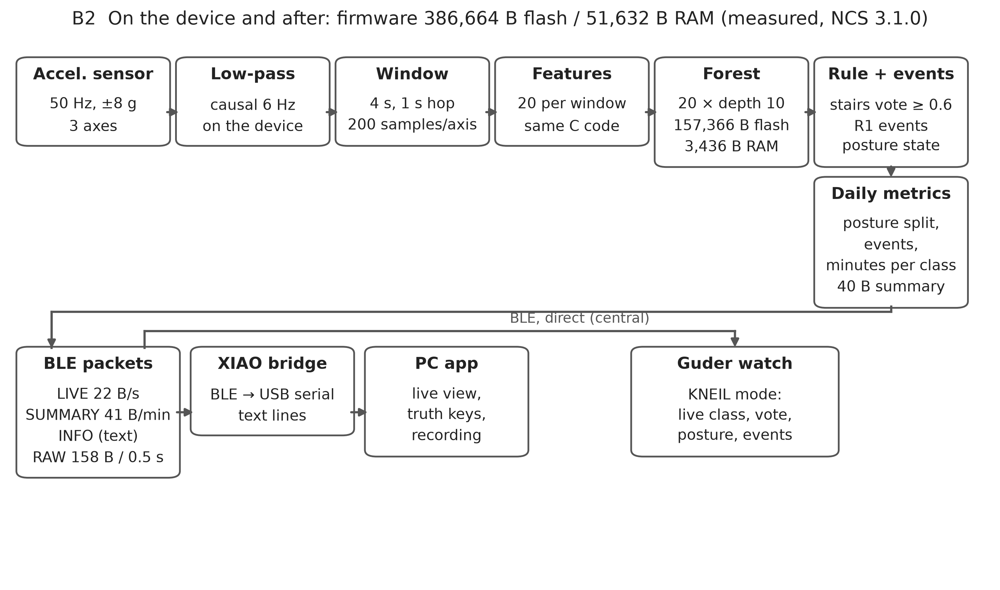
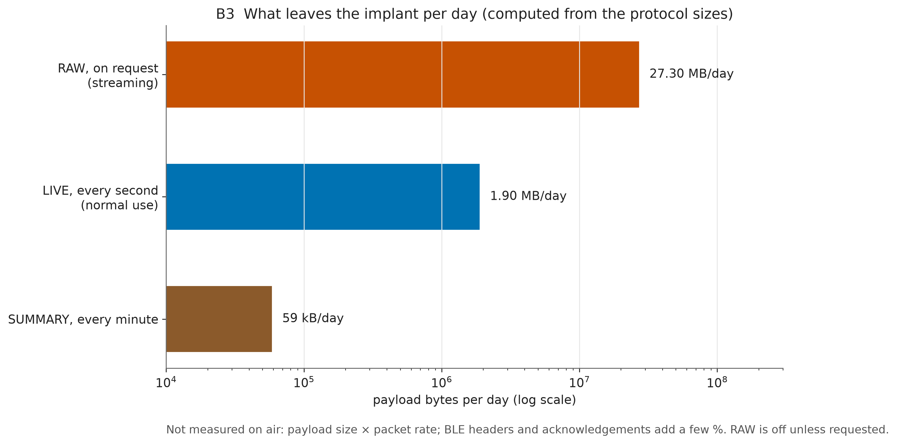
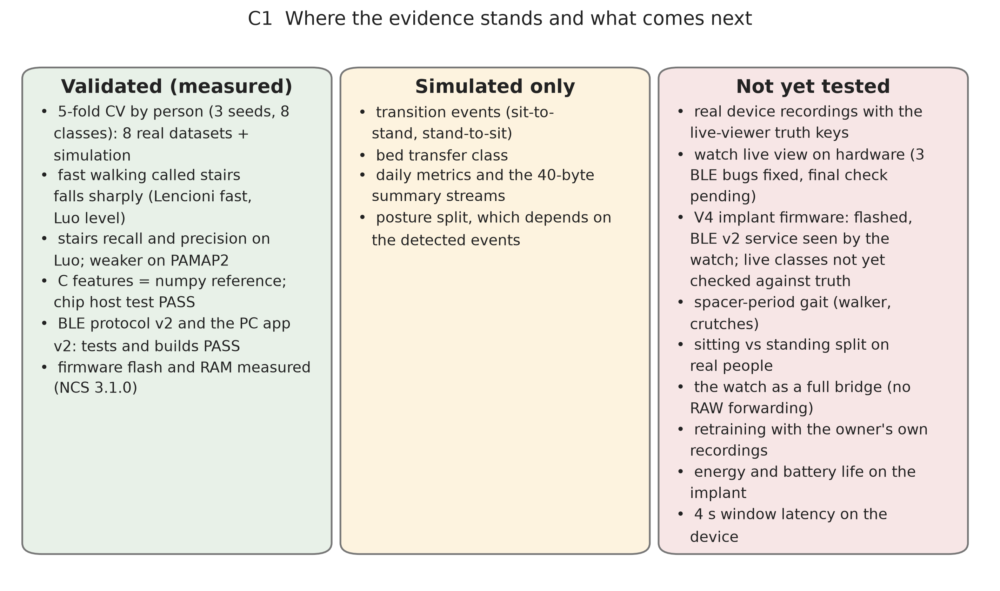

# Figures

Ten figures: one overview of the whole V4 work and nine detail figures, all generated by `pipeline/make_figures.py`
(`make_figures 1.1`) from the result files. Rebuild them with:

```
python pipeline/make_figures.py                 # everything
python pipeline/make_figures.py --only overview  # just the overview
```

It reads the step D results on this PC (`KNEIL_results\v4\stepD`), the E2 build report and the KNEIL protocol files,
needs about 10 s, trains nothing and writes every figure twice (PNG at 300 dpi + SVG; the overview also as PDF) plus
`figures/make_figures_log.txt`, which lists per panel the source file and the values plotted.

Palette: the class colours are the eight `CLASS_COLOURS_V2` values of the PC app
(`../kneil_firmware/pc_app/kneil/protocol.py`), so a class has the same colour everywhere; "today / V3" is always grey and
"V4" always the same blue (lighter blue = V4 without the stairs rule). All accuracy figures are the mean of 3 seeds,
5-fold cross-validation **by person**.

---

## Overview: KNEIL V4 on one slide



One slide that tells the whole V4 story: 312 people from nine public datasets (plus 82 simulated streams) are
transferred to the implant point and cut into 4 s windows, and the chip classifies them and sends 1 Hz class packets to
the XIAO bridge/PC app and, directly over BLE, to the Güder watch. The middle band shows what changed with V4: walking
misread as stairs falls from 17.5 % to 1.2 % (Luo level walking) and from 12.8 % to 0.6 % (Lencioni fast walkers), and
the stairs panel shows the cost (Luo stairs-up recall 50 → 43 %). The bottom band separates measured from simulated and
untested and records the owner's watch log of 17 Nov 2026.

**Sources:** (a) people per dataset from `stepD/windows_v11/windows_W4s.npz` (distinct groups); (b) lever arm, axes and
the Camargo validation (|a| r = 0.93) from `CLAUDE.md`; (c) forest / classifier / firmware sizes from
`tasks/E2_report.md`; (d) packet sizes from `../kneil_firmware/protocol/kneil_proto.h`; (e)-(h) the same files as
A1-A4 (`stepD/D2` predictions + `windows_W4s.npz` with the 0.6 stairs rule, `stepD/D3` CSVs); the watch-log line is
the manager's fact from the owner's watch log (17 Nov 2026), not a file in this repository.

**Limits:** the middle band is offline cross-validation, not the device; the simulated panel/row mixes 60 synthetic
personas and the Camargo replay; the chip sizes are one NCS 3.1.0 build; the watch live view and the implant's live
classes are not yet checked against truth. A dot in (a) is one **cross-validation group with at least one 4 s training
window**: the person for the person-labelled datasets; for Marpino the dataset does not identify people, so its five
recording groups are used; PAMAP2 person 108 and three Caicedo people have no 4 s window and are not counted. The 265
people of the V3 stage 2 index = WearGait-PD 109 + CeTI 32 + KneE-PAD 28 + MHEALTH 10 + PAMAP2 8 + Marpino's 78
recording files, i.e. the same 109 WearGait-PD people, not 183. The figure is a summary: every number is reproduced in
A1-A4 and in the log.

---

## A1 Fast walking misread as stairs



How often a true walking window is called stairs up or down: today's model (V3recipe, 2 s), the chosen V4half model
(4 s) without the stairs rule, and V4half with the rule "stairs only if the forest vote share >= 0.6". Fast walking
misread as stairs falls from 12.8 % to 4.9 % by changing the window, and to 0.6 % with the rule.

**Sources:** `stepD/D3/stairs_rule_results.csv` (today, no rule; the `called` table, keys `speed_abs=fast`,
`surface=FE`, `rec=HurriedPace`) and `stepD/D2/pred_V4half_W4s_8cls_seed{0,1,2}.npz` + `windows_v11/windows_W4s.npz`
(the rule, computed with the code of `pipeline/stairs_rule.py`).

**Do not read:** this is offline cross-validation, not the device. "Walking" here is level walking with the shank IMU
placed as in each public dataset; fast treadmill or hurried outdoor walking is the closest analogue to the device
problem, not the same thing. The rule trades stairs recall for precision (see A3).

---

## A2 Walking recognised per dataset



Walking recall for every dataset of the step D results, in the same three configurations as A1, with the number of
people in each dataset († = fewer than 10 people, so the bar can move several points with one person). V4 is better or
equal almost everywhere; the smallest datasets move most.

**Sources:** `stepD/D2/pred_*_W*s_8cls_seed{0,1,2}.npz` + `windows_v11/windows_W2s.npz` and `windows_W4s.npz`
(recall; the last series applies the 0.6 stairs rule); people = distinct `grp` per dataset in `windows_W4s.npz`.
`*simulated` mixes the 60 synthetic personas with the Camargo replay (22 people).

**Do not read:** the bars are pooled windows, so a dataset with long recordings weighs more in the pooling than its
people count suggests; the CV is by person but the separate datasets still differ in sensor placement, activity mix and
labelling quality.

---

## A3 Stairs recall and precision



Recall (filled) and precision (hatched) for stairs up and down on Luo (30 people) and PAMAP2 (7 people), today versus
V4half 4 s with and without the 0.6 rule. On Luo the rule lifts precision strongly (up 58 to 86 %, down 38 to 69 %) and
costs recall (up 72 to 43 %). PAMAP2 stays weak in every setting.

**Sources:** `stepD/D3/stairs_rule_results.csv` (today, no rule; the `stairs` table) and the predictions + window file
as in A1 (rule 0.6).

**Do not read:** PAMAP2 has 7 people; Luo's stairs numbers depend on the data-driven lever arm (0.26 m) used to build
its implant-site signal. Precision counts windows, not events.

---

## A4 Window-length trade-off



Three quantities against the window length (V4half): stairs F0.5 on Luo, sit-to-stand event recall on simulated data,
and the worst false-event rate per hour. Longer windows help stairs and remove false events, but cost transition recall;
4 s (dashed line) is the chosen compromise.

**Sources:** `stepD/D3/stairs_rule_results.csv` (F0.5, F0.5-tuned rule per window) and
`stepD/D3/transition_events_results.csv` (events: `simulation`, rule R1; false: the largest of the four false-event
sources per window).

**Do not read:** the F0.5 line uses the rule tuned for each window length, so its parameters differ between points; the
event line is simulated data only, and "false events per hour" is the worst source, not an average.

---

## A5 Confusion matrix (real data and simulated)



Row-normalised confusion matrix of V4half at 4 s with the 0.6 stairs rule, mean over the 3 seeds, a separate panel for
real data and for simulated data, with the number of windows per row. Real walking and still are strong (93 % and
99 %); stairs up lose windows to walking and to "still"; the transition classes exist only in the simulated panel.

**Sources:** `stepD/D2/pred_V4half_W4s_8cls_seed{0,1,2}.npz` + `windows_v11/windows_W4s.npz` (truth, `src`, stream ids;
rule from `pipeline/stairs_rule.py`).

**Do not read:** the two panels have very different class mixes, so percentages are not comparable across panels; a
zero-window row (real sit-to-stand, stand-to-sit, bed transfer) means "no data", not "0 %". The simulated
`still -> walking` cell (32 %) comes from the Camargo replay: 3,506 of its 8,755 standing windows (40 %) are called
walking, while the v1.6 synthetic still windows are not affected; standing in the replay includes weight shifting and
the reconstruction noise, which a 4 s window can read as walking.

---

## B1 Training data pipeline



How the training data are made: public shank-IMU, motion-suit, marker and simulated data are transferred to the implant
point with one tibia frame per person and a plausibility rule, low-passed at 6 Hz, cut into 4 s windows every second,
reduced to 20 features by the same C code that runs on the chip, and used to train a 20-tree forest with
cross-validation by person before the emlearn export.

**Sources:** dataset names and people counts from `stepD/windows_v11/windows_W4s.npz` (distinct groups per dataset:
WearGait-PD, Luo, KneE-PAD, PAMAP2, MHEALTH, Marpino as shank IMUs; CeTI as motion suits; Lencioni and Caicedo as
markers; simulation); the steps from `CLAUDE.md`, `docs/STEP_D_SUMMARY.md` and `README.md`.

**Do not read:** box widths and arrow lengths mean nothing; the counts are people per dataset, not hours of data; the
simulation mixes synthetic personas and the Camargo replay.

---

## B2 On the device and after



The signal path on the implant (50 Hz accelerometer, 6 Hz low-pass, 4 s window, 20 features, forest, stairs rule and
events/daily metrics) and after it: the BLE packets feed the XIAO bridge to the PC app, and **in parallel** the Guder
watch, which connects to the implant directly as a BLE central (KNEIL mode). Sizes are the measured firmware size.

**Sources:** sizes from `tasks/E2_report.md` (forest 157,366 B flash, classifier 3,436 B RAM, firmware 386,664 B flash /
51,632 B RAM, 40 B summary); packet sizes from `../kneil_firmware/protocol/kneil_proto.h`.

**Do not read:** the firmware numbers are one build with NCS 3.1.0 and include the BLE stack; the drawing does not show
timing or power, and the watch is a monitor: it does not forward RAW data and is not a replacement for the bridge.

---

## B3 What leaves the implant per day



Payload bytes per day for the three data paths: the normal 1 Hz class packet (about 1.9 MB/day), the daily summary
(about 59 kB/day) and the raw stream if it were left on (about 27 MB/day). RAW is only sent on request, so normal
operation is three orders of magnitude below streaming.

**Sources:** computed from `../kneil_firmware/protocol/kneil_proto.h`: LIVE v2 22 B × 1/s, SUMMARY 41 B × 1/min,
RAW 158 B × 2/s, × 86,400 s/day.

**Do not read:** this is arithmetic on the payload sizes, not measured on air (BLE headers, connection events and
retries add a few percent), and it says nothing about the energy cost, which was not measured.

---

## C1 Where the evidence stands and what comes next



A one-page roadmap: what is validated with measurements, what rests on simulated data, and what has not been tested yet
(including the watch's live view on hardware, where three BLE bugs were found and fixed, and the V4 firmware on the real
implant). It is a plan, not a result.

**Sources:** `docs/STEP_D_SUMMARY.md` ("What is not proven yet"), the open questions of the E1/E2 reports, the watch
reports `tasks/W3_report.md`-`tasks/W5_report.md` and `README.md`.

**Do not read:** the three columns are not equally strong evidence — "validated" means cross-validated on public data and
host-tested code, not tested on a patient or on the implant hardware.
